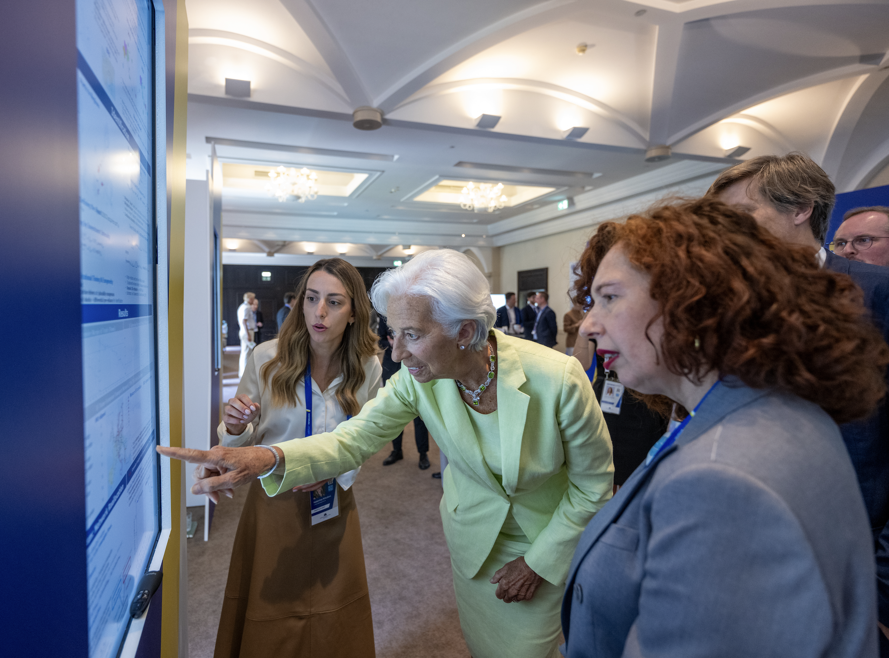

Welcome!

I completed my PhD in Economics at London Business School under the supervision of Hélène Rey in July 2026.  My research interests include **geoeconomics, international macro, trade** and **monetary policy**. 

I am a member of the [Next-Geo cohort](https://www.kielinstitut.de/institute/career/next-geo-program/) and a 2026/27 [Lamfalussy Fellow](https://www.ecb.europa.eu/pub/economic-research/programmes/lamfalussy/html/index.en.html) for the European Central Bank. I was a finalist for the [2026 Young Economist Prize](https://www.ecb.europa.eu/press/conferences/ecbforum/YE_competition/html/index.en.html).

My job market paper is [Ports of Power](https://drive.google.com/file/d/1713SVZYxVORRwxqHDC6wkbTL1O8fZbR9/view). I study the acquisitions of European port terminals by Chinese state-owned companies and their effect on the European trade network.

Before the PhD, I worked at the European Central Bank. I did my pre-doc at the University of Chicago Booth School of Business. I hold a MSc in Economics from University College London and a BSc in Philosophy, Politics and Economics from the University of Warwick.

Previous papers include [Monetary Policy and Regional Inequality](/files/MPRI.pdf) (R&R on _The Economic Journal_) and [The Globalization of Corporate Control](/files/globalization.pdf) (_Journal of International Economics_). 

Previous papers include [Monetary Policy and Regional Inequality](https://knikalexi.github.io/files/MPRI.pdf) (R&R on The Economic Journal) and [The Globalization of Corporate Control](https://knikalexi.github.io/files/globalization.pdf) (Journal of International Economics).

Building on *Ports of Power*, I am developing early-stage work on the physical interface of economic power, studying maritime infrastructure and monetary policy, and strategic oil reserves as an instrument of economic statecraft.

Here is my [CV]({{ "/files/Katerina_CV_2308.pdf" | relative_url }}). You can contact me on <a href="mailto:knikalexi@london.edu">knikalexi[at]london[dot]edu</a>.

